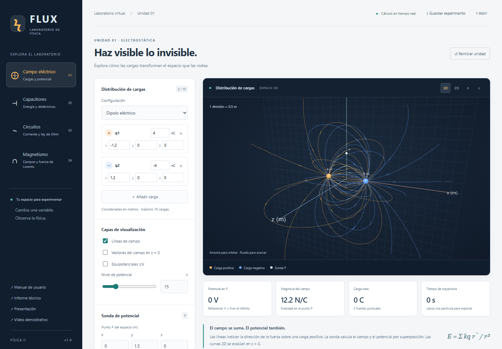

# FLUX · Simulador de Física II

Laboratorio interactivo de campos eléctricos y magnéticos en **2D y 3D**, capacitores y circuitos. Interfaz en español, cálculos en unidades SI y experimentos reproducibles.



## Utilizar el simulador

**[Abrir aplicación web](https://legends600.github.io/simulador-fisica-2-3d/)**

Para ejecutarlo desde el código fuente, instala **Node.js 22 o posterior** y abre una terminal en el proyecto:

```sh
npm ci
npm run dev
```

Abre **http://127.0.0.1:4173**. Se requiere HTTP: no abras `index.html` con doble clic. Los módulos 3D necesitan WebGL 2. Después de instalar las dependencias, la aplicación funciona localmente sin CDN ni servicios externos.

```sh
npm run build   # Genera dist/ con Three.js y todos los recursos locales
npm start       # Sirve la versión distribuible
```

## Entregables

| Entregable | Acceso |
| --- | --- |
| Código fuente | Este repositorio; motor físico en `src/physics.js` |
| Manual de usuario | [Manual web](https://legends600.github.io/simulador-fisica-2-3d/docs/manual.html) |
| Informe técnico | [Fundamentos, arquitectura, algoritmos y validación](https://legends600.github.io/simulador-fisica-2-3d/docs/informe.html) |
| Video demostrativo | [Reproductor y capítulos](https://legends600.github.io/simulador-fisica-2-3d/docs/video.html) · [archivo WebM](docs/media/demostracion-flux.webm) |
| Presentación para la defensa | [Presentación web](https://legends600.github.io/simulador-fisica-2-3d/docs/presentacion.html) · [PowerPoint editable](docs/presentacion-flux.pptx) |
| Apoyo para exponer | [Guía de defensa](docs/defensa.md) · [guion del video](docs/guion-video.md) |
| Verificación | [Registro de validación](docs/validacion.json) |

El video dura aproximadamente **6 minutos**, muestra la aplicación real y contiene subtítulos integrados en español. **No tiene pista de audio.** La presentación contiene 12 diapositivas y notas del expositor. En su versión web: flechas para avanzar, **N** para notas y **F** para pantalla completa. El manual y el informe incluyen un estilo de impresión para guardarlos como PDF desde el navegador.

## Funcionalidades por unidad

| Unidad | Implementación |
| --- | --- |
| Electricidad y potencial | Hasta 10 cargas editables; presets; líneas y vectores de campo; curvas y superficies equipotenciales; sonda de potencial; trayectorias de partículas |
| Capacitores y dieléctricos | Placas 3D; área, separación y permitividad; cálculo de C, Q, U y E |
| Corriente y ley de Ohm | Circuitos serie, paralelo y mixtos; hasta 4 etapas con 4 ramas; voltaje, corriente y potencia por resistencia; gráfica I–V; carga y descarga RC |
| Fuerza y campo magnético | Imán dipolar, conductor infinito y espira; sonda vectorial; trayectorias de Lorentz con campos E y B cruzados |

También permite guardar/abrir experimentos JSON, descargar capturas PNG y exportar trayectorias CSV con tiempo, posición y velocidad en SI.

## Pruebas

```sh
npm test
```

Los casos verifican soluciones analíticas, simetrías, Kirchhoff, balance de potencia, energía magnética y convergencia de orden dos del integrador. No comparan únicamente la implementación consigo misma.

Para las pruebas de interfaz, inicia primero `npm run dev` en otra terminal:

```sh
npx playwright install chromium
npm run test:ui
```

En Windows, el script puede utilizar Chrome o Edge ya instalados en un perfil temporal aislado. `BROWSER_PATH` permite elegir otro ejecutable; `BASE_URL` permite indicar otra dirección. Se prueban entradas, exportación/importación, animaciones, 390/768 px y errores de recursos. Las capturas se guardan en `assets/`; los registros temporales quedan en `.qa/` (ignorado por Git).

## Arquitectura

```text
src/physics.js    Funciones puras y algoritmos físicos
src/scene.js      Three.js: escena, líneas, mallas y cámara
src/charts.js     Esquemas y gráficas SVG
src/app.js        Estado, controles y archivos de experimentos
tests/           Casos analíticos y propiedades físicas
scripts/         Servidor, build, QA y generación de entregables
docs/            Manual, informe, diapositivas, video y defensa
```

Three.js es la única dependencia de ejecución. No hay backend, cuentas, analítica ni servicios de pago. `npm run build` incorpora Three.js localmente y conserva su licencia.

## Modelos y límites

- Fuentes eléctricas fijas y partículas de prueba clásicas. Se detiene la trayectoria al alcanzar una carga, salir del radio de 8 m o llegar a los límites de tiempo/muestras.
- Las líneas tienen una densidad elegida para visualización; la sonda proporciona las magnitudes físicas. En vista XY, las curvas equipotenciales se calculan en z = 0.
- Capacitor ideal de placas paralelas con V constante, sin efecto de borde ni pérdidas.
- Circuitos reducibles por etapas serie/paralelo; una fuente de CC y un capacitor en el modo RC. No resuelve puentes arbitrarios, CA o RLC.
- Dipolo ideal, hilo infinito y espira de filamento. Las sondas señalan las regiones excluidas.
- Los valores q y m en Lorentz son didácticos (C y kg), no parámetros de un electrón real.

Consulta el [informe técnico](docs/informe.html) para las ecuaciones, las aproximaciones numéricas y las referencias. El archivo Word original se usó como especificación y no se publica.

## Reproducir los entregables

```sh
node scripts/docs.mjs          # Manual, informe y reproductor
node scripts/slides-web.mjs    # Presentación web desde docs/slides-data.js
npm run demo:record            # Recorrido real de 6 minutos; requiere servidor y navegador
```

La generación opcional del PowerPoint usa el runtime Artifact Tool de Codex; el archivo final ya se incluye y no requiere ese runtime para abrirse. `scripts/slides-pptx.mjs` acepta `ARTIFACT_MODULE`, `PRESENTATION_SKILL_DIR` y `CODEX_ARTIFACT_RUNTIME`. La aplicación y su build son independientes de esas herramientas.

La publicación en GitHub Pages se hace mediante el workflow incluido. Primero ejecuta pruebas, luego empaqueta `dist/` y despliega la misma versión.
